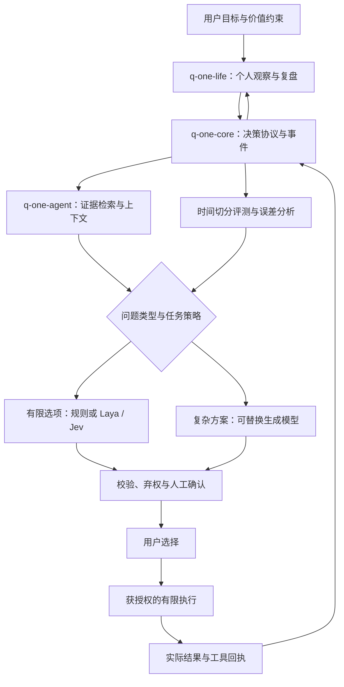

# Q-One 多学科融合蓝图

版本：研究蓝图 0.2；日期：2026-10-23。目标：将“万事万物皆可量化”转化为可定义、可观察、可比较、可修正的个人决策系统。

**当前交付是研究选型与实现路线。现有三个仓库仍为初版原型：真实 Laya/Jev、通用生成模型、检索、长期记忆和图形界面尚未接通；此前仅完成语法与提交检查，未完成真实端到端验收。**

## 1. 汇聚原则

吸收每个来源最适合的问题表示、机制或评测方法，再放入同一协议接受比较。遇到观点冲突，保留冲突和适用条件：快速模型负责有限选项的局部判断，生成模型负责提出方案和解释，用户决定价值取舍，结果数据检验可观测的预测。

本轮的 29 条来源见[研究矩阵](../literature/MATRIX.zh-CN.md)。这是有选择的初筛。大多数论文仅核查摘要及元数据；各条阅读深度单独注明。下一轮应精读优先候选的正文、实现和失败分析，而不是先扩充数量。

## 2. 六类信息必须保持区别

| 信息 | 例子 | 保存方式与边界 |
| --- | --- | --- |
| 用户价值 | 更看重陪伴还是工作进度 | 明确陈述、可修改；由用户决定 |
| 观察 | 今日专注时长 | 带单位、时间、来源与缺失原因 |
| 证据 | 论文、文档、设备记录 | 原出处、版本、片段与适用范围 |
| 判断 | 当前更适合哪个工具 | 选择分布、模型版本、输入与策略版本 |
| 预测 | 在指定行动下达成标准的概率 | 行动、目标事件、期限、预测时点 |
| 结果 | 实际选项及是否达到事前标准 | 用户确认或明确来源；未知保持未知 |

可量化的表示依赖测量定义与语境。关系质量、意义感等可以有主观记录和定性补充，不能由一次评分代表其全部含义。哲学或个人信念可以成为用户声明的价值框架，不能被标记为预测已验证。

## 3. 技术融合地图

| 能力 | 来源ID | 取用机制 | 实现归属 | 验收证据 |
| --- | --- | --- | --- | --- |
| 快速类型化判断 | S01 Laya、S02 Jev、S28、S29 | choice/score/noul；明确问题边界 | agent | 同一任务集的分类表现、拒答、顺序敏感性与完整链路成本 |
| 复杂推理与方案生成 | S03 Qwen3、S04 DeepSeek-R1 | 生成候选、受控思考预算、可验证子任务 | agent | 方案可执行、证据支持、约束满足；不靠模型自评分证明 |
| 证据检索 | S05 RAG | 外部证据、出处与时间 | agent | 引用能支持相应论断；无证据时明确缺失 |
| 工具工作流 | S06 ReAct、S23 LangGraph | 有反馈的步骤、持久状态与人工中断 | agent/core | 恢复与重试后副作用不重复；错误步骤可定位 |
| 长期记忆与复盘 | S07 Reflexion、S08 MemGPT | 分层记忆、反馈记录 | agent/life | 更正、过期、删除能传播；反思不自动变成事实 |
| 概率评估 | S13、S14、S15 | 适当评分、校准集、条件成立时的预测集合 | core | 预测事件与结果配对；独立校准与留出评测 |
| 多目标权衡 | S24 pymoo | 约束、支配关系、候选权衡集合 | life | 展示时间与收益等代价；权重可由用户调整 |
| 个人使用循环 | S18、S19、S20 | 观察—反思—行动、自主性、反馈延迟 | life | 实际使用负担、数据缺失、可撤销选择与定性反馈 |
| 个体干预研究 | S21、S25 | 明确反事实、时间顺序与单人研究记录 | life/research | 先精读方法、写假设和退出条件；观察相关性不冒充效果 |
| 训练与系统优化 | S09 DSPy、S10 LoRA、S11 DPO、S12 vLLM | 固定指标后的优化、适配与服务 | agent | 相同留出任务上出现可复算增益；允许无增益 |
| 多模态背景 | S22 I-JEPA | 表征学习研究 | 独立探索 | 有明确数据、预测对象与有效比较后再考虑实现 |
| 本地工程教学 | S26、S27 | 示例组织、mock/真实模型分离 | agent | 只读参考；授权未确认前不复制第三方实现 |

## 4. 目标架构



该图是目标架构。选择规则、provider 和阈值都需要版本。阶段一先用一个生成模型、一种快速模型与规则基线，避免无法确定增益来自哪一项。

## 5. 概率契约是第一优先级

`confidence`、选项类别分布、用户偏好和行动成功概率是不同量。Laya/Jev 给出的判断概率需要保留原含义，不能填入一个含糊的“人生成功率”。

下一版拟增加以下预测契约（当前尚未实现）：

```json
{
  "prediction_id": "P-example",
  "decision_id": "D-example",
  "option_id": "draft",
  "event": "在约定期限前产出符合事前标准的初稿",
  "event_version": "criterion-v1",
  "issued_at": "带时区的时间",
  "horizon_end": "带时区的时间",
  "probability": null,
  "probability_kind": "outcome_given_selected_action",
  "model_revision": "待固定",
  "evidence_ids": [],
  "calibration_status": "uncalibrated"
}
```

仅当概率有定义、结果与同一事件对应且没有使用未来信息时才计分。若用户选了另一个方案，应把原方案结果标为未观测，或明确采用独立定义的可观测预测任务。对采用建议的样本计分仍存在选择偏差，不能宣称反事实效果或因果提升。[S15](../literature/notes/S15-proper-scoring.md)、[S21](../literature/notes/S21-what-if.md)

本轮已修正 `q-one-core/src/qone_core/report.py` 的选项错配：仅计分实际选择了推荐选项的已结算二元结果，列出排除原因、记录ID与分母。7项开发测试（含合成CLI流程）通过，且覆盖选项用例在原实现上会失败。这是报告逻辑的开发验证，不是模型校准或用户收益证据；版本化目标事件与期限契约仍待实现。

原型中的 `confidence < 0.70` 和 `personal_calibration_n < 20` 是暂定策略，不是论文证明的通用阈值。20条记录只能作为初期使用检查点，不能据此宣布概率已校准或可以自动执行。

## 6. 必须先补的工程契约

| 优先级 | 问题 | 需要的改变 |
| --- | --- | --- |
| P0 | 决策与结果错配 | 已修正选择配对与排除记录；版本化预测事件、期限等契约仍待补齐 |
| P0 | 状态变更只在CLI里检查 | 库调用与CLI统一校验；校验与追加在同一事务/锁范围内完成 |
| P0 | 日志完整性被高估 | 哈希链只能发现部分篡改；没有独立保存的头哈希不能可靠发现删尾或重写整链 |
| P0 | 输入与版本边界 | 拒绝非有限数、解析带时区时间、校验schema版本；当前存在未覆盖路径 |
| P1 | 个人指标不可比 | 补单位、方向、目标区间、定义版本和复盘窗口；累计历史不能冒充本周状况 |
| P1 | 未做真实验收 | 安装与起止入口、真实输入、重复运行、错误处理与依赖版本回执 |
| P1 | 真实模型未连接 | 保存checkpoint/API版本、输入摘要、解析结果、延迟和失败；mock单列 |

`q-one-life` 当前把数值越大视为分数越高，尚不适用于希望更低或落在区间内的指标；当前也未实现按时间窗口过滤。两个JSONL实现对POSIX采用文件锁，Windows分支未提供同等并发保障，正式跨平台支持前需要补齐。

## 7. 首个可落地场景

先做“本周学习与专注安排”：用户声明可用时间、任务、截止日期及恢复约束；录入有限观察；模型提出几个明确方案；用户确认；到期记录是否完成与实际花费。这样可以验证完整流程，并保留时间、负担和定性体验的权衡。

最初只选择少量定义稳定的指标。每个指标注明单位、频率、缺失原因、希望增加/减少/达标区间和更改版本。用户可以跳过、修正或停止记录。系统应展示观察与证据，不根据有限记录推断用户人格。

## 8. 分阶段验收

| 阶段 | 产物 | 进入下一阶段的条件 |
| --- | --- | --- |
| M0 选型 | 本蓝图、29条来源、采用矩阵 | 关键原始来源可核查，未知明确标记 |
| M1 协议修正 | 预测/结果契约、合法状态机、时间与指标版本 | 覆盖选项、非法状态、未来数据等反例能被识别 |
| M2 一条真实链路 | Laya与一个生成模型适配器、规则基线 | 真实输入走完：记录—建议—确认—结果；每次有回执 |
| M3 个人复盘 | 指标窗口、纠错、缺失与导出 | 连续使用一个约定窗口，记录耗时和用户反馈 |
| M4 比较评测 | 冻结的中文任务集与时间留出集 | 比较规则、快速模型、生成模型、混合流程；阈值只在开发集选择 |
| M5 知识与记忆 | 证据索引、检索、失效与删除传播 | 引用正确性、过期事实、检索失败可检验 |
| M6 可选适配 | 提示优化或LoRA/DPO | 有合规可用数据和可验证瓶颈，留出集显示可复算增益 |
| M7 扩展 | 更多领域或多模态 | 已验证场景稳定；每个新领域重新定义标准和边界 |

没有为未运行阶段填写性能、工时或完成日期。本轮完成的是 M0 的初筛交付；后续全文复核与工程验收仍需继续。

## 9. 如何判断值得采用

每项候选写一张卡：当前问题 → 来源机制 → 最简单基线 → 增加的复杂度 → 验收方式 → 失败与撤回条件。评估正确率、拒答/升级、代价、延迟、重复运行稳定性、用户负担和最终状态。选择分布的校准、方案预测的校准、工作流成功率分别统计。

S29 提醒我们把选项顺序、相似候选、输入截断、阈值过拟合和完整链路成本放进评测；这些是从预印本借鉴的评测问题，不是认可其模型排名。S16、S17用于借鉴验收结构，不把自建案例称为通过官方基准。

## 10. 长期维护

核心来源统一登记，代码与权重按版本固定。新的结论附数据与运行回执，失败样本同样保留。涉及第三方实现时分别保存许可证与必要声明；托管服务只作为显式配置的可替换选项。

用户改变目标时，保留旧价值和指标版本的生效时间。系统的改进以某一明确场景中可复查的收益为依据，同时让用户看到代价、未知和可选择的替代方案。

## 11. 与并行研究提案的关系

仓库在本轮工作期间另有已提交并发布的 [SYNTHESIS.md](SYNTHESIS.md)、[ARCHITECTURE.md](ARCHITECTURE.md) 和 [MILESTONE1_PREREG.md](MILESTONE1_PREREG.md)。本轮保留这些文件，未复核其中全部来源、证据等级或跨项目实验数字。本来源库的核查范围仅以登记的29条为准。

协议升级前需统一以下分歧；当前保持为提案，不宣称实现完成：

| 待统一问题 | 本轮处理 |
| --- | --- |
| 点概率与概率区间如何记录和计分 | 先固定预测事件与选择配对；区间必须另定义语义与合适评分规则，不能直接代入二元Brier |
| 20/30条样本与置信度阈值 | 区分流程检查点、描述统计及统计推断；样本数不自动构成效度或校准保证 |
| “v0.2采纳”与运行代码的关系 | 设计采纳、schema迁移、实现、验收分别登记；当前包版本仍为0.1.0 |
| 既有跨项目经验的引用 | 独立核查可公开性、实验来源和适用范围后才用于Q-One性能论断 |

合并提案时以明确任务、来源条件和项目内证据作决定，允许多个观点共存，避免把任何一份综述当作所有领域的最终答案。
